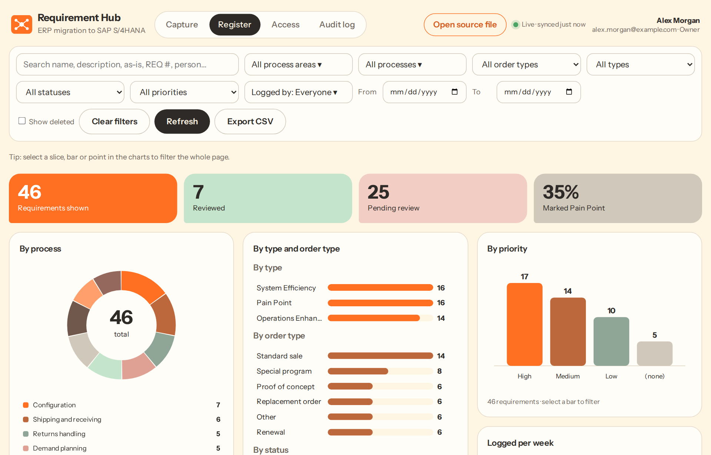
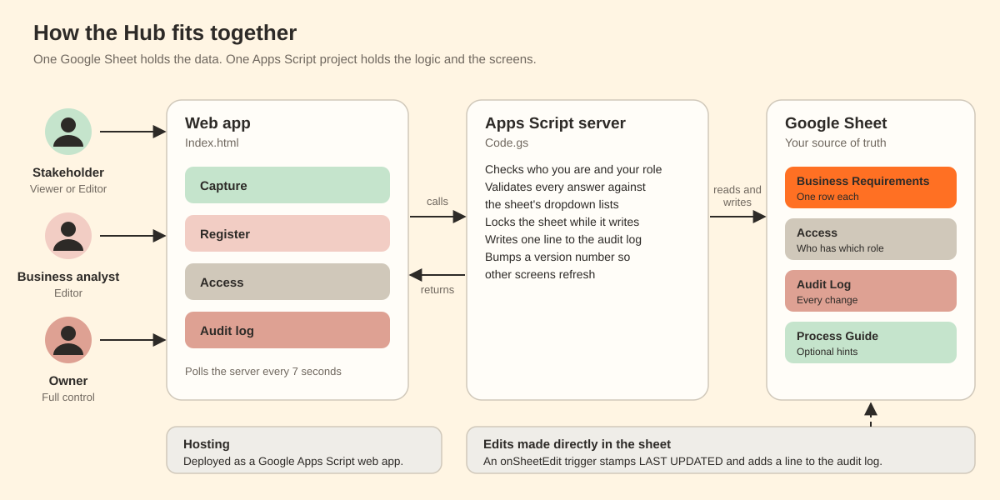
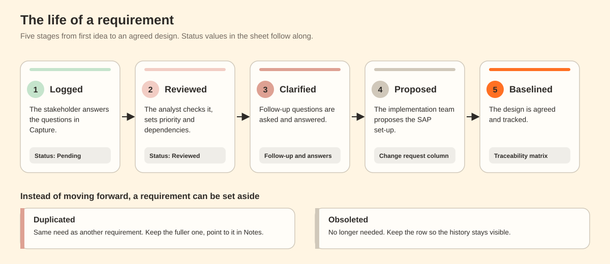
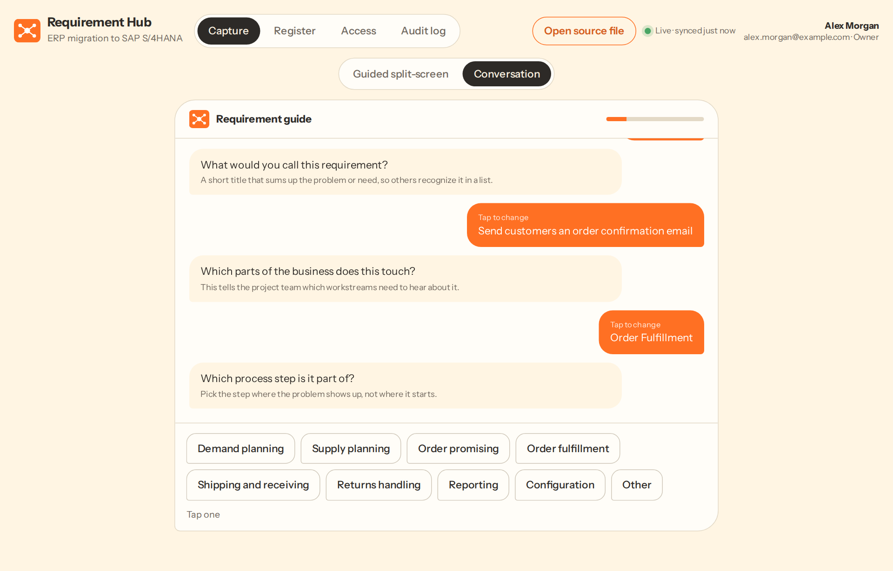
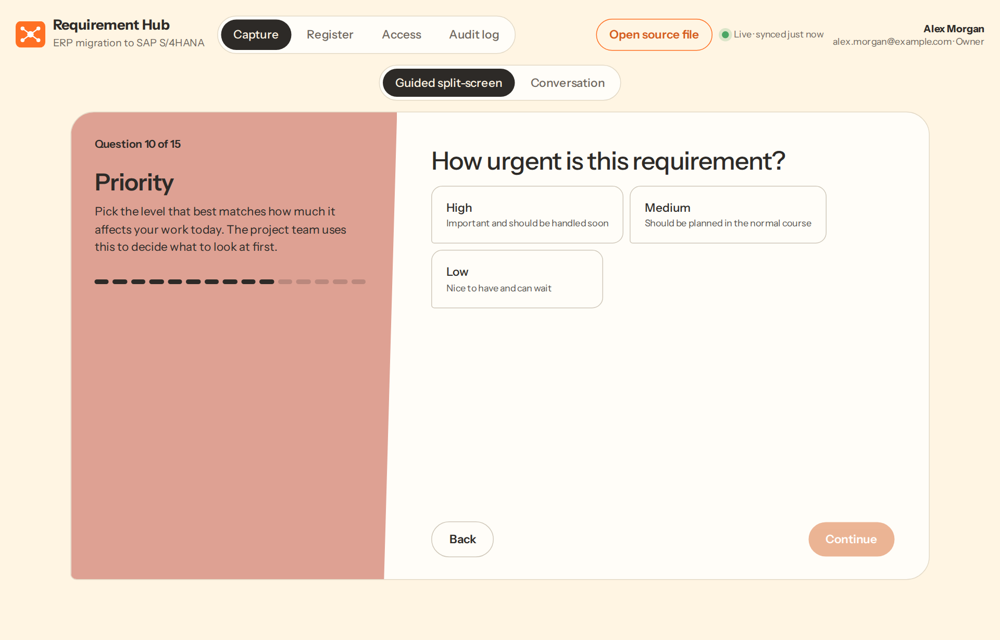
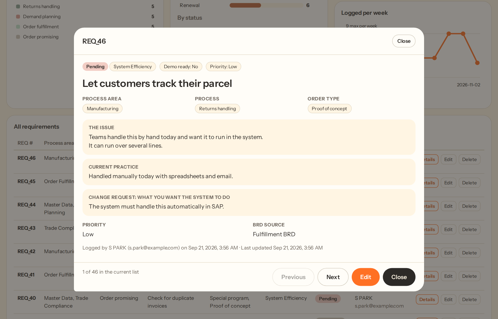
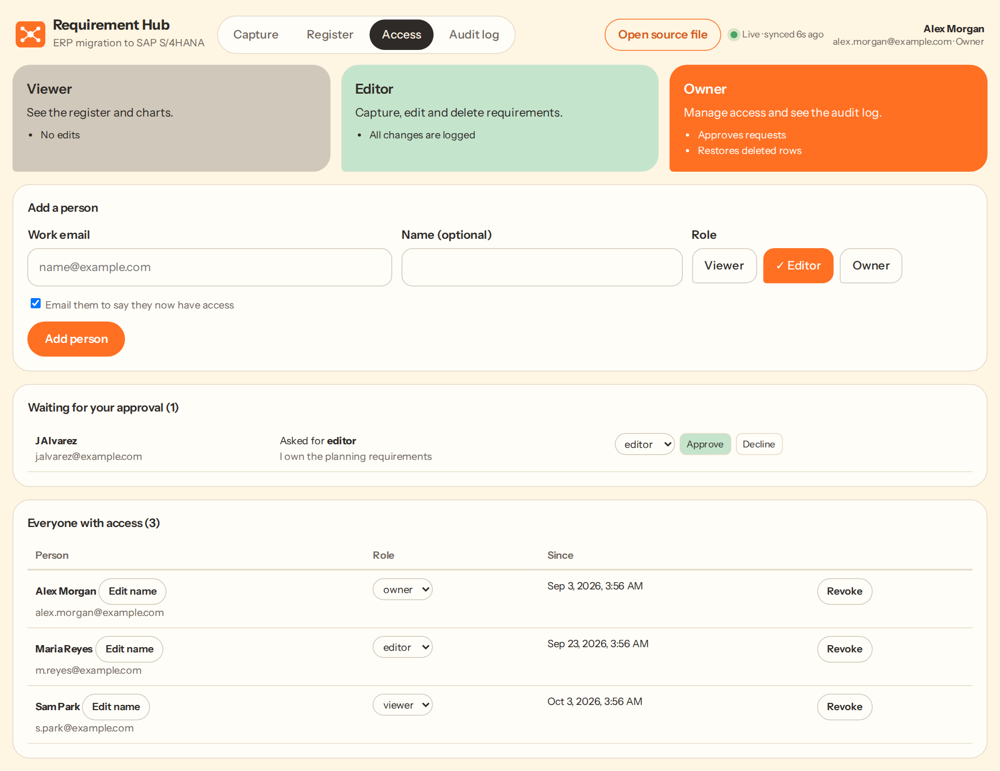

# SAP S/4HANA Business Requirement Hub

**A guided web app that helps business teams record, review and track their requirements for an ERP migration to SAP S/4HANA, all in one Google Sheet.**



**Built with:** Google Apps Script, Google Sheets, HTML and JavaScript

**Features:**
- A guided questionnaire that captures a requirement in about three minutes, in a split-screen or conversation layout
- A Register with filters, number tiles and charts. Select a slice, bar or point and the whole page filters to it
- Three roles (Viewer, Editor, Owner) with an access request and approval queue
- An audit log of every change, whether it was made in the app or in the sheet
- Live sync with the source sheet, so an edit in either place shows up in both within seconds
- Safe editing: the app checks each answer against the sheet's dropdown lists and refuses to overwrite a newer change

**How to use:** Open the web app at `[your web app link]`, choose **Capture**, answer the questions and save. Review and filter requirements in **Register**. To install your own copy, follow [docs/setup.md](docs/setup.md).

---

## Start here

| I want to... | Go to |
|---|---|
| See it working in two minutes | Open [prototype/index.html](prototype/index.html) in a browser. It uses sample data and nothing leaves your computer. |
| Learn the job as a new Business Analyst | [docs/new-ba-guide.md](docs/new-ba-guide.md), a five-day plan with checks |
| Install my own copy | [docs/setup.md](docs/setup.md) |
| Let an AI assistant set up or maintain the app | [skills/requirements-hub-setup](skills/requirements-hub-setup/SKILL.md) |
| Understand how it is built | [docs/architecture.md](docs/architecture.md) |

## Who it is for

| Role | What they do | What the app lets them do |
|---|---|---|
| **Stakeholder** | Owns a business process and knows what hurts | Capture requirements, add notes, edit their own |
| **Business analyst** | Reviews, prioritizes and clarifies requirements | Everything above, plus filter, triage, flag duplicates and export |
| **Owner** | Runs the Hub | Everything above, plus approve access, read the audit log and restore deleted requirements |

Roles in the app are called **Viewer** (read only), **Editor** (capture, edit, delete) and **Owner** (full control).

## How it works



The web page you see is served by Google Apps Script. It calls a small server script that checks your role, validates your answers and writes to one Google Sheet. The sheet stays the single source of truth, so you can still filter, pivot and share it the way you always did. More in [docs/architecture.md](docs/architecture.md).

## The life of a requirement



## A look at the screens

| Capture (conversation) | Capture (split-screen) |
|---|---|
|  |  |

| Details | Access |
|---|---|
|  |  |

## Repository layout

```
.
├── README.md
├── LICENSE
├── CHANGELOG.md
├── src/                         The app. Paste these into Apps Script.
│   ├── Code.gs                  Server code
│   ├── Index.html               Screens and client code
│   └── appsscript.json          Project settings and permissions
├── prototype/                   Clickable prototype with sample data (one file)
├── sample-data/                 A starter template for the source sheet
├── docs/
│   ├── new-ba-guide.md          Five-day guide for a new Business Analyst
│   ├── setup.md                 Install and deploy
│   ├── architecture.md          How it works
│   ├── sheet-structure.md       Every column, and the rules for editing the sheet
│   ├── triage-rules.md          Priority, dependency, data level and duplicate rules
│   └── images/                  Diagrams and screenshots
├── skills/
│   └── requirements-hub-setup/  An agent skill for setup, deployment and upkeep
└── fonts/                       Instrument Sans (SIL Open Font License)
```

## Make it yours

The sample values in this repo are placeholders. Before you use it for real:

1. Replace `your.name@example.com` in `src/Code.gs` with the first Owner's email.
2. Set up your own dropdown lists in the sheet. The app follows the sheet, so you do not edit code to change a list.
3. Replace the sample process hierarchy in the **Process Guide** tab with your own.
4. Never commit real sheet IDs, email addresses or web app links to a public repository.

## Prototype

The prototype in [prototype/](prototype/) is a single HTML file that runs the real screens against made-up data. A **What to try** button maps what a Business Analyst expects to the screen that delivers it, and the **View as** buttons switch between roles. Changes you make reset when you reload the page.

To share it, turn on GitHub Pages (Settings, Pages, deploy from the main branch) and open `/prototype/`.

## Licence

MIT. See [LICENSE](LICENSE). The font files in `fonts/` use the SIL Open Font License, included alongside them.
