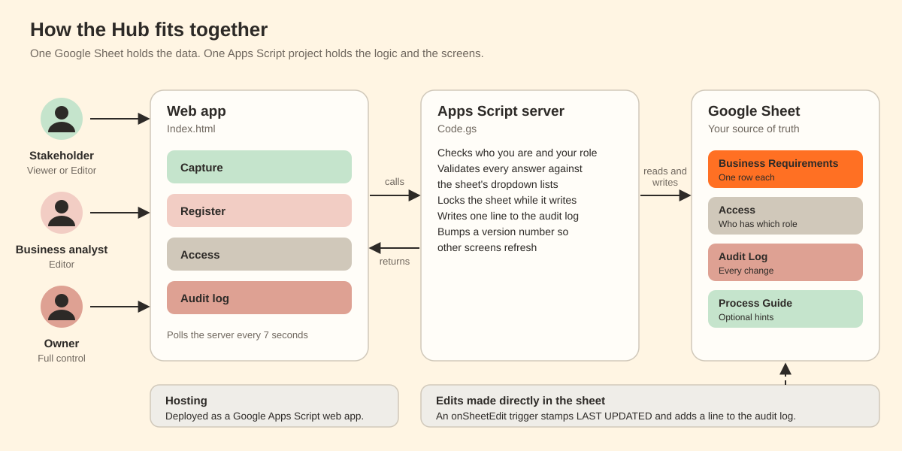

# How it works

## Parts

| Part | File | Job |
|---|---|---|
| Web app | `src/Index.html` | The four screens: Capture, Register, Access and Audit log. Runs in the browser |
| Server | `src/Code.gs` | Checks roles, validates answers, writes to the sheet, keeps the audit log |
| Sheet | Your Google Sheet | The data. Also the Access list, the audit log and the process guide |
| Manifest | `src/appsscript.json` | Runtime, web app settings and permissions |

The browser calls the server with `google.script.run`. Every call returns plain data or a plain-language error.

## What happens when someone saves

1. The browser sends the answers to `saveRequirement`.
2. The server looks up the person's role. A Viewer is refused.
3. The server takes a script lock for up to 25 seconds, so two saves cannot collide. If it cannot get the lock, the person sees "Someone else is saving at the same moment. Please try again in a few seconds."
4. Each answer is checked against the sheet's dropdown list. Matching ignores case, and the value is saved with the sheet's own spelling.
5. The server checks that every column it needs exists. If one is missing, it writes nothing.
6. It writes the row. If anything fails, it clears the row (new) or restores the old values (edit).
7. It adds a line to the audit log and raises a version number.

## Editing safely

When you open the Edit window, the app remembers the row's LAST UPDATED value. If someone changes the row before you save, the server compares the two and refuses with "Someone changed REQ_12 while you were editing." Nothing is overwritten.

## Live sync

- The server keeps a version number in script properties. Every write, from the app or from the sheet, raises it.
- Each open screen asks for that number every 7 seconds. If it has changed, the screen reloads its data.
- The screen shows "Synced Ns ago" so people can see it is live.

## Edits made in the sheet

An installable **onSheetEdit** trigger runs when someone edits the Business Requirements tab:

- It stamps LAST UPDATED on any edit.
- For a brand-new row, it also stamps LOGGED ON and RESPONDER EMAIL.
- It adds a line to the audit log with the source **Google Sheet**.

Edits made through other tools (for example an API) do not fire this trigger, so they are not logged and do not raise the version number. Press **Refresh** in the Register to see them.

## Finding columns

The server finds each column by its header name, not its letter. Headers are normalized (upper case, letters and digits only) and a few accept two names or only the start of a name. Inserting or moving columns is safe. Renaming a header is not. If a needed column cannot be found, Owners see a banner that names it.

## Lists

Dropdown choices come from the sheet's data validation on the first data row. The server caches them for five minutes. If a list cannot be read, it falls back to the sample lists in `Code.gs`.

## Roles

| Role | Can do |
|---|---|
| Viewer | Read the Register and charts, edit their own name |
| Editor | Viewer, plus capture, edit and delete requirements |
| Owner | Editor, plus manage people, read the audit log, restore deleted requirements |

Deleting marks the row DELETED = Y. Only Owners can see or restore it. There must always be at least one Owner.

## Limits

- Apps Script has daily quotas for runtime and email. Check Google's current limits before you roll out to a very large group.
- One script lock means saves happen one at a time. This is fine for a team and is a deliberate trade-off for safety.
- Every call runs as the deploying account, so that account needs edit access to the sheet.
