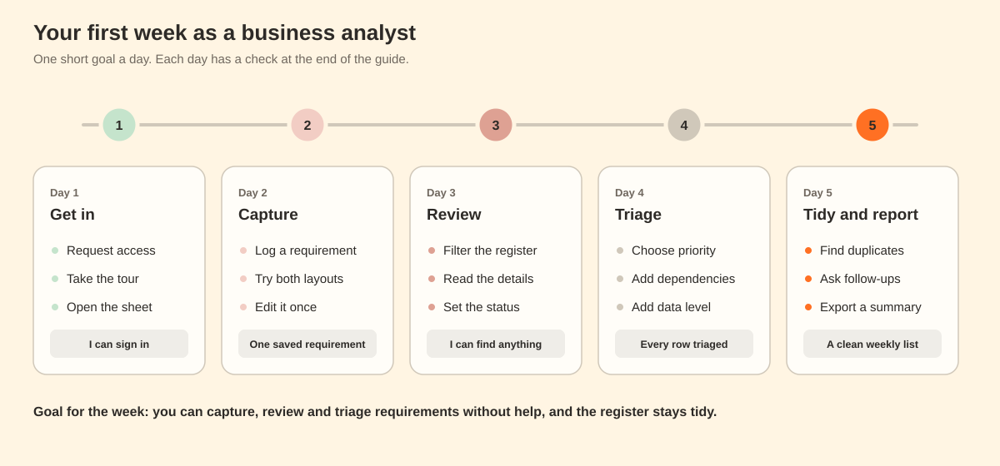

# Your first week as a Business Analyst

This guide takes you from "I have never opened the Hub" to "I can capture, review and triage requirements without help". It has five short days. Each day has a goal, steps you can follow, and a check at the end.

**Time:** 30 to 60 minutes a day.
**You need:** the web app link, a Google account that can open it, and a few minutes of an Owner's time on Day 1.

**Practice first.** Open the [clickable prototype](../prototype/index.html). It has the same screens and made-up data, so you cannot break anything. The **What to try** button walks you through the main tasks.

---

## Words you will meet

| Word | Meaning |
|---|---|
| Requirement | One business need, written as a problem and what the system should do about it |
| Stakeholder | The person who owns the process and raised the need |
| Register | The Hub screen that lists every requirement |
| Capture | The Hub screen where you answer questions to log a requirement |
| Owner, Editor, Viewer | Your role. Viewers read. Editors read, capture, edit and delete. Owners also manage access, read the audit log and restore deleted requirements |
| Process area (L2) | A part of the business, such as Sales or Logistics |
| Process (L3) | A named process inside an area |
| As-is | How the work is done today |
| Change request | What the business wants the system to do |
| ERP | The business software a company runs on, such as SAP S/4HANA |
| Backlog | The list of requirements waiting to be reviewed |

---

## Day 1: Get in

**Goal:** you can open the Hub, you know your role, and you have looked around.

1. Open the web app link you were given.
2. If you see a **Request access** form, type your name, check that **Editor** is selected under **Role you need**, and write one line under **Why do you need it?** For example: "I review sales requirements for the migration." Press **Send to Owners**.
3. Ask an Owner to approve it. They see your request in the **Access** tab. You get an email when they decide.
4. Reload the page. You should see the tabs **Capture**, **Register** and **Access**. Owners also see **Audit log**.
5. Take a two-minute tour.
   - Open **Register**. Read the four number tiles at the top.
   - Click a slice of the **By process** chart. The page filters to that process. Click it again to clear.
   - Click **Details** on any row. Press the left and right arrow keys to move between requirements.
6. Press **Open source file**. This opens the Google Sheet that holds the data. Find the **Business Requirements** tab and look at the header row. Do not rename or delete anything there.
7. If the sheet has a **HOME** tab, read it. It explains the other tabs.

**Check yourself**
- [ ] I can see Capture and Register.
- [ ] I know my role: ______
- [ ] I can find the Business Requirements tab in the sheet.

---

## Day 2: Capture your first requirement

**Goal:** you save one real requirement and you edit it once.

### Before you start: what makes a good requirement

Write it so that someone who was not in the meeting can understand it. Cover four things:

| Part | Question it answers | Example |
|---|---|---|
| Who | Which role has the problem? | A sales assistant |
| When | What event starts it? | A customer places an order |
| What | What should the system do? | Send a confirmation email with the order number and delivery date |
| How you will know | What shows it is done? | Every new order triggers an email within a minute |

**Weak:** "Better confirmations."
**Strong:** "When a customer places an order, the system must email a confirmation with the order number and delivery date, so customers do not need to call us."

### Steps

1. Open **Capture**. Pick a layout at the top: **Conversation** feels like a chat. **Guided split-screen** shows one question at a time. The Hub remembers your choice.
2. Answer the questions. Press **Continue** after each one.

| # | Question | Where it goes | Tip |
|---|---|---|---|
| 1 | Your name | Responder name | Filled in for you. Check it |
| 2 | Requirement name | Requirement name | Six to ten words, starting with a verb or the thing |
| 3 | Process area | L2 process area | Pick every area that is touched. The **i** button explains each area |
| 4 | Process | Process | Pick the one closest process |
| 5 | Type | BRD type | Pain Point = it hurts today. System Efficiency = the system could do it for us. Operations Enhancement = a better way to run it |
| 6 | Order type | Order type | Pick every type that applies |
| 7 | The issue | Description | **Required.** Say what goes wrong and who feels it |
| 8 | Current practice | As-is process | **Required.** Describe the steps people take today |
| 9 | Change request | Change request | What should the system do? Start with "The system must" |
| 10 | Priority | Priority | Pick the level that fits. See Day 4 |
| 11 | Supporting documents | Data source / use cases | Paste links. Skip if you have none |
| 12 | Lucid chart | Lucid chart | Paste a link to a process diagram. Skip if you have none |
| 13 | Demo ready | Demo ready | Yes, No or Maybe: can you walk the project team through it? |
| 14 | Personal note | Notes | Anything you want to remember. Skip if empty |
| 15 | Review | | Check each answer, then press **Save** |

3. Press **Save**. You see **REQ_n saved**, with a note that it is in the Register and in the Google Sheet with status Pending.
4. Open **Register**, find your requirement, and press **Details**. Check that it reads well.
5. Press **Edit**, change one word in the description, and save. Check that the change appears.

> **If the save is refused** with "Someone changed REQ_12 while you were editing. Your changes were not saved. The latest version has been loaded.": someone else saved first. Look at the latest version and make your change again. The Hub never overwrites a newer change.

**Check yourself**
- [ ] I saved one requirement and can find it in Register.
- [ ] I edited it once.
- [ ] I tried both capture layouts.

---

## Day 3: Review the register

**Goal:** you can find any requirement in under a minute and you know how to set its status.

1. Open **Register**. Try each filter and watch the number tiles change.

| Filter | Use it to |
|---|---|
| Search box | Find words in the name, description, as-is, REQ number or person |
| Process areas, Processes | Tick several at once. A requirement matches if it has any of them |
| Order types, Types, Statuses, Priorities | Narrow to one value |
| Logged by | Tick one or more people |
| From and To | Limit by the date it was logged |

2. Click a chart slice, bar or point. A tag appears above the tiles. Click the tag's cross, or **Clear filters**, to remove it.
3. Open **Details** on a requirement. Read it top to bottom: issue, current practice, change request, links.
4. Decide a status and set it. Press **Edit**, choose a **Status**, and save.

| Status | Use it when |
|---|---|
| Pending | The requirement is logged and waiting for review |
| Reviewed | You read it and it is clear enough to act on |
| Duplicated | It repeats another requirement (see Day 5) |
| Obsoleted | The need no longer exists |
| (blank) | A draft, still being written |

5. If something is unclear, ask. In **Edit**, write your question in **Follow-up question (BA to stakeholders)**. The stakeholder answers in **Answers (stakeholders to BA)**. Keep one question per line, so each can be answered and closed.
6. Press **Export CSV** to download what you see. Share it in a meeting or a message.

**Check yourself**
- [ ] I filtered to one process and one priority.
- [ ] I changed a status to Reviewed.
- [ ] I asked one follow-up question.

---

## Day 4: Triage

**Goal:** every requirement you reviewed has a priority, its dependencies and a data level.

Full rules and examples are in [triage-rules.md](triage-rules.md). The short version:

### Priority

| Level | Use when | Example |
|---|---|---|
| **High** | Needed for legal or regulatory compliance, financial control, a customer commitment, safety, go-live or a critical end-to-end process, and no acceptable workaround exists | A tax rule that must be right on every invoice |
| **Medium** | Important for efficiency, control, user experience or process quality, but the business can run for now with a reasonable manual workaround | Automating approvals that people now chase by email |
| **Low** | A helpful enhancement, convenience, optimization or rare edge case that can wait with little business risk | Cosmetic report changes |

**Test:** ask "If this is not done at go-live, what happens?" If the answer is a legal, financial or customer problem with no workaround, it is High.

### Dependencies

A dependency names the area of the business that must also work for this requirement to work. Put one or more in the **Order behavior / dependency of rule** column. Order them from most to least important.

| Dependency | Covers |
|---|---|
| Product setup | How products are configured, quoted and priced |
| Master data | Shared records such as customers, materials, suppliers and addresses |
| Planning | Forecasting, supply planning, capacity and lead times |
| Order to cash | Order entry, stock checks, delivery, invoicing, payments and collections |
| Procure to pay | Suppliers, purchase orders, receiving and paying supplier invoices |
| Delivery and shipping | Moving goods to customers: picking, carriers, tracking and customs |
| Operations | Day-to-day work in warehouses and with partners, including inventory and builds |
| Finance | Accounting, financial control and reporting |
| Returns | Return approval, receipt, repair, resale or disposal |

Your organization may use other names. Keep the list short and agree it as a team.

### Data level

Set the **Data level** column in the sheet. It is a backend field, so it does not appear in Capture.

| Value | Meaning | Example |
|---|---|---|
| Main/Master Data | Attributes of a shared thing that many processes use | Customer, material, bill of materials, address |
| Transactional Data | A business event or document | Order, purchase order, shipment, return, report |
| Grocery/Lookup Data | A rule, mapping or list that other records look up | Order types, reason codes, email templates |

### Steps

1. In **Register**, filter **Statuses** to **Pending**.
2. For each requirement: read it, then set the **Priority** in **Edit**.
3. Open the sheet. In the same row, fill **Order behavior / dependency of rule** and **Data level**.
4. Set the status to **Reviewed** when all three are done.
5. After about ten, check your work. Filter **Priorities** to **High**. Are they all truly High? Most backlogs have far more Medium than High.

**Check yourself**
- [ ] Each reviewed requirement has a priority, a dependency and a data level.
- [ ] My High list is short and I can defend each item.

---

## Day 5: Tidy and report

**Goal:** you can spot duplicates, close follow-ups and send a weekly summary.

### Spot duplicates

Two requirements are duplicates when they describe the same need, under the same conditions, with the same expected outcome, even if people used different words. Compare these six things:

| Test | Ask whether both have the same |
|---|---|
| Persona | User or business role |
| Trigger | Event that starts the process |
| Process step | Where in the process it happens |
| Capability | What the business needs the system to do |
| Outcome | The result the business expects |
| Acceptance | How you know it is done |

If most match and nothing meaningful differs in scope, rule, exception, timing or data, they are duplicates.

**Not duplicates:**
- **Same topic, different outcome.** "Check stock when an order is placed" and "reassign stock after a delivery is late" are two requirements.
- **One contains the other.** "Automate returns" can contain separate requirements for authorization, receipt and disposition. That is parent and child.
- **Same need, different system layer.** One business need can lead to several technical items. Keep it as one requirement.
- **Partial overlap.** Rewrite both so each has its own outcome.

### Flag a duplicate

1. Keep the fuller requirement. This is the **canonical** one.
2. Open the other one. Press **Edit**, set **Status** to **Duplicated**, and write in **Notes**: `Duplicate of REQ_12 (canonical). Same need: ... Flagged for confirmation.`
3. In the canonical requirement's notes, add: `Also raised as REQ_30.`
4. Do not delete the duplicate. Keep who raised it and when.
5. Ask the business owner to confirm before anyone merges or closes it.

### Close the loop

1. Filter **Statuses** to **Reviewed** and open any with a follow-up question. If it has an answer, update the description and clear the question.
2. Check requirements with no priority: filter **Priorities** to **(none)**.

### Weekly routine (15 minutes)

- [ ] Filter **Pending**. Review or ask a question on each one.
- [ ] Filter **(none)** priority. Set a priority.
- [ ] Look for duplicates in the newest requirements.
- [ ] Press **Export CSV** and send the summary.
- [ ] If you are an Owner, open **Audit log** and scan the week.

**Check yourself**
- [ ] I can explain why two requirements are, or are not, duplicates.
- [ ] No requirement I own is waiting more than a week for review.

---

## Quality checklist for any requirement

- [ ] The name says what the system should do.
- [ ] The issue says who is affected and what goes wrong.
- [ ] The current practice lists the real steps.
- [ ] The change request starts with "The system must".
- [ ] It has a priority, dependencies and a data level.
- [ ] It does not repeat another requirement.
- [ ] Links open and are not private to one person.

## Common problems

| What you see | What to do |
|---|---|
| No **Capture** tab | Your role is Viewer. Ask an Owner to change it to Editor |
| "Request access" form | You are not on the list yet. Send a request |
| A dropdown is missing a value | Ask an Owner to add it to the sheet's dropdown. The Hub picks it up within five minutes |
| "Someone changed REQ_12 while you were editing" | The latest version is already loaded. Make your change again. Nothing was lost |
| "Someone else is saving at the same moment" | Wait a few seconds and press **Save** again |
| Your change in the sheet is not showing | Wait up to ten seconds, or press **Refresh** |
| You deleted something by mistake | Ask an Owner. They can restore it from Register with **Show deleted** |

## Rules that keep the Hub healthy

- Add and change requirements in the Hub when you can. It checks the choices and records who did it.
- Do not rename or move the sheet's column headers.
- Do not delete rows in the sheet. Use **Delete** in the Hub, so an Owner can restore it.
- Do not type in the five system columns (Responder name, Responder email, Logged on, Last updated, Deleted).

## What next

- Read [triage-rules.md](triage-rules.md) in full.
- Read [sheet-structure.md](sheet-structure.md) to learn every column.
- Ask your Owner to walk you through the **Audit log**.
