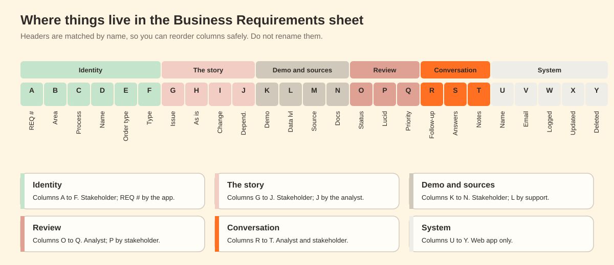

# The Business Requirements sheet

## Columns

The app finds columns by header name. You can reorder them, but do not rename them.

| Col | Header | What it holds | Filled in by |
|---|---|---|---|
| A | REQ # | Reference such as `REQ_12` | Web app |
| B | L2- PROCESS AREA | One or more areas, separated by commas | Stakeholder |
| C | PROCESS | The process | Stakeholder |
| D | REQUIREMENT NAME | A short name | Stakeholder |
| E | ORDER TYPE | One or more order types | Stakeholder |
| F | BRD TYPE | Pain Point, System Efficiency or Operations Enhancement | Stakeholder |
| G | DESCRIPTION (also accepted: SIGNIFICANCE / DESCRIPTION) | What the issue is | Stakeholder |
| H | AS IS PROCESS | How it works today | Stakeholder |
| I | CHANGE REQUEST | What the system should do | Stakeholder |
| J | ORDER BEHAVIOR / DEPENDENCY OF RULE | Dependencies. See [triage-rules.md](triage-rules.md) | Analyst |
| K | DEMO READY | Yes, No or Maybe | Stakeholder |
| L | DATA LEVEL | Master, transactional or lookup. Backend only | Analyst or support |
| M | BRD SOURCE | Where the requirement came from | Analyst |
| N | DATA SOURCE/USE CASE(S) | Links to documents | Stakeholder |
| O | STATUS | Pending, Reviewed, Duplicated or Obsoleted | Analyst |
| P | Lucid Chart | Link to a process diagram | Stakeholder |
| Q | PRIORITY | High, Medium or Low | Stakeholder, then analyst |
| R | Follow-up Question | Analyst's question. Only the start of the header must match | Analyst |
| S | ANSWERS | Stakeholder's answer. Only the start of the header must match | Stakeholder |
| T | NOTES/COMMENTS | Anything else, including duplicate references | Anyone |
| U | RESPONDER NAME | Who logged it | Web app |
| V | RESPONDER EMAIL | Their email | Web app |
| W | LOGGED ON | When it was logged | Web app |
| X | LAST UPDATED | Last change, from the app or the sheet | Web app and trigger |
| Y | DELETED | `Y` if deleted in the app | Web app |

Columns U to Y are added by `setup()`.

## Rules for editing the sheet directly

- Do not rename or delete headers.
- Do not delete rows. Delete in the app so an Owner can restore it.
- Do not type in U to Y.
- It is safe to filter, sort, add columns, add formulas in new columns, and change cell colors.
- Existing rows have no LOGGED ON date unless you fill it in, so date filters and the weekly chart only include rows captured after launch.

## Dropdown lists

Add a dropdown (Data, Data validation) to the first data row of each of these columns. The app copies the choices into its forms and filters.

PROCESS AREA, PROCESS, ORDER TYPE, BRD TYPE, DEMO READY, STATUS, PRIORITY. DATA LEVEL is a dropdown in the sheet only.

When you change a list, the app picks it up within five minutes. A value removed from a list stays visible on old rows and can still be edited, but it cannot be chosen for new ones.

## Other tabs

| Tab | Purpose | Who edits |
|---|---|---|
| Access | Who has which role, with requests and decisions | Owners, through the app |
| Audit Log | Every change with who, what, old value, new value and source | Nobody. Protected |
| Process Guide | Optional text shown in the process area picker | Owners |

Access and Audit Log are protected, so only the account that runs the app can change them directly.
